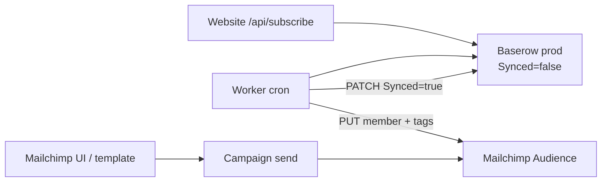

# Mailchimp API feasibility (subscribe sync + branded notifications)

**Branch:** `explore/mailchimp-subscribe-sync`  
**Date:** 17 July 2026  
**Verdict: GO**

Mailchimp’s Marketing API covers the same Baserow → ESP sync and on-brand notification needs as the parked Buttondown experiment. Proceed to a sync Worker only after this GO is accepted.

## Requirements (unchanged)

| Need | Detail |
|------|--------|
| Site signup | Baserow only (`web/functions/_lib/subscribe.js`: `Email`, `Tag`, `Synced=false`) |
| Production only | Table `1017358` |
| Sync | Drain `Synced=false` → ESP, then `Synced=true` |
| Tags | Baserow `Tag` multiple_select (e.g. `prelaunch`, `wifi`) |
| Brand | Hull `#0d0d0d`, cream `#e8e4dc`, gold `#c9a84c`, serif; client-reliable HTML |
| Scale | ~200 subscribers |
| Out of scope | Staging table; site → ESP; two-way unsub → Baserow; RSVP / Mandrill |

Campaign writing can stay in the Mailchimp UI at first. Hard requirements: **list sync via API** and **sendable on-brand HTML**.

## Architecture

## Endpoint map

Base URL: `https://{dc}.api.mailchimp.com/3.0`  
Auth: HTTP Basic with any username and the API key as password (`Authorization: Basic …`), or the SDK equivalent. `{dc}` is the data-centre prefix on the key (e.g. `us21`).  
`subscriber_hash` = MD5 of the **lowercase** email address.

| Requirement | Method / path | Notes |
|-------------|---------------|--------|
| Upsert subscriber | `PUT /lists/{list_id}/members/{subscriber_hash}` | Body: `email_address`, `status`, `status_if_new` (e.g. both `"subscribed"`) |
| Already on list | Same PUT | Upsert; no Buttondown-style collision header |
| Apply tag | `POST /lists/{list_id}/members/{subscriber_hash}/tags` | `{ "tags": [{ "name": "prelaunch", "status": "active" }] }` |
| Batch backfill | `POST /lists/{list_id}` | `members` array; good for first ~200 |
| Cap per run | Client-side | e.g. 100 rows/run, same as Buttondown plan |
| Branded HTML | Custom-coded template (account) + optional `PUT /campaigns/{id}/content` `{ "html": "…" }` | Full document; avoid theme+CSS fights |
| Send campaign | UI or `POST /campaigns/{id}/actions/send` | UI enough for occasional notifications |

## Baserow → Mailchimp field map

| Baserow | Mailchimp |
|---------|-----------|
| `Email` | `email_address` (trim + lowercase before hash and PUT) |
| `Tag` | Member tags: each value → `{ name, status: "active" }` |
| `Synced` | Set `true` only after successful upsert (and tag, when present) |
| `Signed up` | Optional later via merge field; not required for v1 sync |

## Account setup (before Worker)

1. Mailchimp Audience (list); note **Audience ID** (`list_id`).
2. API key with Marketing API access; note **data centre** suffix.
3. **Standard** plan (or higher) if sending custom-coded HTML templates. Free/Essentials are not enough for coded templates.
4. Env (planned): `MAILCHIMP_API_KEY`, `MAILCHIMP_AUDIENCE_ID`, plus existing `BASEROW_API_KEY` / sync secret pattern.

At ~200 contacts, Standard is typically far cheaper than Buttondown whitelabel (~$79/mo) for equivalent HTML control.

## Product / compliance gates (not API gaps)

| Gate | Decision for v1 |
|------|-----------------|
| Consent | Use `status: "subscribed"` / `status_if_new: "subscribed"` assuming site signup is valid single opt-in. Switch to `pending` (DOI) only if legal requires it. |
| `unsubscribed` / `cleaned` | Do **not** force back to subscribed. Treat as sync complete for Baserow (or skip with a logged reason) so rows do not retry forever. |
| RSVP / transactional | Stay off Mailchimp Marketing; existing RSVP email path unchanged. Mandrill out of scope. |
| Two-way unsub | Out of scope; Mailchimp remains source of truth for list unsubscribes. |

## Why GO (vs Buttondown CSS path)

- Upsert + tags are first-class and match the Baserow drain model.
- Custom HTML templates give a full dark shell (inline styles / `bgcolor`), same reliability class as Gwenda RSVP HTML, without overriding a white `.email-container`.
- Scale (~200) is well inside Marketing API limits if we cap work per cron run.

## Explicit verdict

**GO** — Mailchimp Marketing API satisfies sync + branded notification requirements.

**Done (email):** branded HTML at [`brand/email/`](../brand/email/) (grand opening campaign created in Mailchimp UI/API).

**Done (sync):** [`utils/subscribe-mailchimp-sync/`](../utils/subscribe-mailchimp-sync/) (hourly cron, manual POST, local dry-run, `SIGNEDUP` merge field). Setup: `npm run setup:subscribe-mailchimp-sync`. The Buttondown ESP experiment branch was retired; Mailchimp is the live path.

**NO-GO would mean:** Standard plan unavailable, or consent rules forbid API `subscribed` without DOI and DOI is unacceptable for UX. Neither blocks the API itself.
